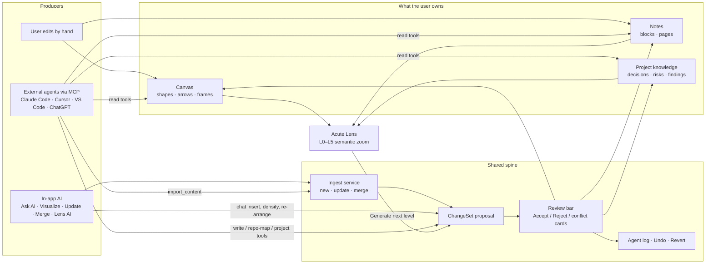

# Acute-Notes — Feature Map

All of the app's features in one place: what each feature is, what a user can do with it, how the features connect, and what is built versus planned.

_Checked against the code on 2026-10-19. Everything runs in a **local install** (web dev server or the Electron desktop app). There is no hosted version yet._

Related docs: positioning and claims are in [product-positioning.md](product-positioning.md). Full behaviour is in [acute-notes-prd-claude-code-ai.md](acute-notes-prd-claude-code-ai.md). Lens is covered in [acute-lens-plan.md](acute-lens-plan.md), MCP in [chatgpt-mcp-architecture-and-test-plan.md](chatgpt-mcp-architecture-and-test-plan.md), and ingest in [ingest-service.md](ingest-service.md).

---

## 1. The big picture

Acute-Notes is an **Excalidraw whiteboard whose objects are real notes**: rich blocks, pages, tables, to-dos, and diagrams. Three groups of "producers" can put content on it:

1. **The user, by hand.** No AI is needed.
2. **The in-app AI**, using the user's own AI connection: Ask AI, Visualize, Update, Merge, and Lens AI.
3. **External agents over MCP**: Claude Code, Cursor, VS Code, Codex, and ChatGPT (PoC only).

Every change made by AI or an agent ends up in the **same shared review**: a ChangeSet that the user accepts or rejects. Accepting it is a single undo step, and the change is logged so it can be reverted.

**Principle:** the canvas is for thinking spatially, a block holds structured content, and a page holds deep detail. AI creates a version of the understanding, and the user owns the result.

---

## 2. Feature catalogue

Features are grouped into five areas. IDs (C1, A1, …) are used in the matrices below.

### A. Core notes & canvas (no AI, never behind a flag)

| ID | Feature | What the user can do |
| --- | --- | --- |
| **C1** | Workspaces & canvases | Create, rename, delete and reorder workspaces and canvases. Move a canvas to another workspace. Browse the navigator tree, which shows pages per canvas. |
| **C2** | Canvas (Excalidraw) | Use the native tools: shapes, arrows, lines, drawing, images, frames. Add composite shapes such as cylinder, hexagon and document. Choose between plain arrows and routed **architecture arrows**. Add web embeds (with a framing check and an option to import the HTML instead). Use "Move to canvas…". |
| **C3** | Rich blocks | Add Text, Todo, Table and Code blocks to the canvas and edit them inline with BlockNote. Mermaid code blocks are previewed as diagrams. `acute-chart` JSON is drawn as a chart. Paste is smart about HTML versus Markdown, and TSV pastes into tables. |
| **C4** | Pages | Write Notion-style documents. A page shows on the canvas as a preview card (full or compact) and opens in a side panel with a slash menu, toggles and images. |
| **C5** | Typed relationships | Give an arrow a meaning, such as `depends_on`, `calls`, `flows_to` or `reads/writes`. Relations are worked out from arrows, so they can never point at nothing. |
| **C6** | Interactive architecture frames | Turn on diagram mode for a frame. Give nodes a kind (frontend, backend, database…), a sublabel, tags and details. The frame gets a legend and info cards. Selecting a node opens a "passport" card and dims everything outside its neighbourhood. **⇢ Path** lights up the route between two nodes. |
| **C7** | Project knowledge nodes | Add decision, constraint, finding, open question, risk, milestone, progress and annotation nodes. **Promote** moves a finding to validated and then to a decision. **Choose** picks between options. Nodes can refer to nodes on other canvases. |
| **C8** | Search | Ctrl+F searches the current canvas. A background workspace index (with secrets redacted) feeds navigator search, AI context and MCP search. |
| **C9** | Undo / redo | One undo stack covers the canvas and the content of blocks. A drag or an editing session counts as one step. |
| **C10** | Export / import | Export PNG or SVG, or copy to the clipboard. Export a canvas as `.acute.json` or Markdown, or a page or block as `.md`. Export and import a whole workspace or canvas as a bundle; the import is validated before anything is written. |
| **C11** | Mermaid → canvas | Convert flowchart, state, class, ER, sequence, pie, gantt and architecture Mermaid into native objects. This runs locally with no AI. |
| **C12** | Local storage & desktop app | Data is local-first: IndexedDB in the browser and SQLite in the Electron desktop app. Saves happen automatically and a save indicator shows their state. There is no cloud sync. |

### B. In-app AI (needs `NEXT_PUBLIC_AI_FEATURE=on` + the user's AI mode On)

| ID | Feature | What the user can do | Writes? |
| --- | --- | --- | --- |
| **A1** | **Ask AI chat** | Open "✨ Ask AI" and ask questions about the selection, the canvas or the workspace. Quick actions: Explain, Summarize, Turn into tasks, Create test cases, Create plan, and Find related (local, no AI). **Insert on canvas** / **Insert as todo** proposes a new block. Chat history is searchable and can be exported to Markdown. | Only creates new blocks. **The chat never edits existing notes.** Updating notes goes through A3. |
| **A2** | **Visualize** | Paste text or select content, then choose **✨ Visualize** and pick one of 10 templates: Flow, Problem→Cause→Solution, Concept Map, Timeline, Decision Tree, Architecture, Comparison, Action Plan, Sections, and more. The result is native, editable frames, blocks, shapes, arrows and linked pages. Content that is already structured (Mermaid, ASCII trees, Archify JSON) is converted locally without AI. Follow-ups: a coverage row ("AI placed N%"), Regenerate for a section, Keep as text, and dense-block review with "Visualize better" (AI) or "Split locally" (no AI). | Proposes new objects. |
| **A3** | **Update / Re-visualize / Re-arrange** | These appear in Ask AI when the selection came from a Visualize run. **Update from new content** re-plans only the parts that changed, and anything the user edited becomes a conflict card (Apply / Keep mine / View diff). **Re-visualize with AI** re-runs only the selected sections. **Re-arrange layout** uses no AI and only moves objects, in the selected sections only. | Proposes updates, adds, removes and moves. |
| **A4** | **Topic merge & shared-chat import** (`NEXT_PUBLIC_TOPIC_MERGE`) | In Visualize, choose **Merge into existing notes**: new content is matched to existing topics and only what is new is added. When sources disagree, the user sees a "Needs your call" box and picks an option with **Use this option**. Statements that changed over time go to a "Changed over time" page. **From shared chats** imports ChatGPT share links; Ask AI → **Update from ChatGPT chats** does the same for an existing note. | Proposes merges. |
| **A5** | Decision models | AI Connections lets the user pick a cheaper or faster "decision model" for routing tasks: outlining, merge assignment, Lens navigation and search. If it is not set or fails, the app falls back silently to the main model. | — |
| **A6** | Providers, credentials, usage | The user brings their own AI. **Validated:** a GitHub Copilot subscription and a Gemini key. **Wired but not validated:** OpenAI, Azure, Anthropic, Ollama, OpenRouter and others. Keys are encrypted on the device. AI settings show "Usage this month". | — |

### L. Acute Lens (semantic zoom over the canvas)

Lens is a side panel. It builds a hierarchy you can drill into from the canvas's architecture frames (C6) and project nodes (C7). **Lens never writes on its own.**

| ID | Feature | What the user can do | Needs AI? |
| --- | --- | --- | --- |
| **L1** | Lens navigation | **Architecture profile:** L0 System → L1 Architecture → L2 Component → L3 Flow → L4 Operation → L5 Source. **Project profile:** lanes of decisions, risks, findings and other project nodes. Users get a level rail, a breadcrumb, and drill-down across canvases. | No |
| **L2** | Evidence | Code references grouped by role (implementation, test, config, doc), plus a source card that links out to VS Code or GitHub. Acute never reads the files itself. | No |
| **L3** | Trace & Impact | **Trace** finds the shortest named path between two nodes, across levels and canvases. **Impact** shows which nodes were modified, which are affected, and which are related. | No |
| **L4** | Agent Sync | An "● Agent Sync" chip with Pause, ghost previews of pending agent changes, and stale markers. | No (driven by MCP) |
| **L5** | Lens AI | **✨ Explain** a node. **Ask Lens** in plain language (it tries a local trace first). **✨ Generate next level**, proposed onto a companion "· detail" canvas. **Ask your IDE agent** copies an MCP prompt for levels backed by code. | Yes (the user's connection) |
| **L6** | Design review | HLD questions (14, for L0–L2) and LLD questions (11, for L3–L5). Each question gets a local seen / not seen chip. An AI verdict per question: strong / partial / gap / unknown. Topic reviews: Requirements, Capacity, "What breaks at N×", Failure modes, Tradeoffs. The output is text only. | Yes. **Tested offline only; don't market it yet.** |

### M. MCP integration (external agents read & write the canvas)

The MCP server runs **inside the user's browser tab**. Next.js only relays requests to it. Clients connect with a per-workspace token (local) or with a secret URL or OAuth (remote/ChatGPT). Setup is under ⋮ → **MCP access**, which offers a ready-made `claude mcp add` command and agent instruction files for Claude, Codex and Cursor.

| ID | Tool group | What an agent can do (tool names) | Writes go through review? |
| --- | --- | --- | --- |
| **M1** | Read | `search_workspace`, `get_canvas`, `get_page`, `get_selected_content`, `get_related_objects`, `list_blocks`, `get_block` | n/a |
| **M2** | Create & update notes | `create_block`, `create_page`, `create_table`, `create_todo`, `update_block`, `create_connection`, `update_connection`, `move_object`, `group_blocks`, `delete_object`, `delete_connection` | Yes. Deletes are always reviewed. |
| **M3** | **Architecture / visual diagrams** | `render_visual_plan`: the agent sends a whole VisualPlan (architecture, flow, timeline, comparison…) and Acute lays it out | Yes |
| **M4** | **Repo Map** | `begin_repo_map`, `upsert_map_section` (one module per frame), `link_map_nodes`, `get_map_status` (stale cards), `remove_map_nodes`, `tidy_map_section`. The agent reads the repo; Acute never does. | Yes. Auto-accept per session can be turned on, by the user only. |
| **M5** | Project memory | **Reads:** `get_project`, `get_decisions`, `get_open_questions`, `get_implementation_plan`, `get_session_context`, `get_recent_changes`, `get_session_history`, `get_session_review`. **Writes:** `create_project`, `record_decision`, `log_finding`, `update_knowledge`, `annotate`, `update_progress`, `sync_session`, `revert_agent_changes` | Yes (reverts and constraints are never auto-accepted) |
| **M6** | Lens | `get_lens`, `trace_lens_path`, `get_lens_impact`, `focus_lens` (UI only), `link_lens_detail` | `link_lens_detail` is reviewed |
| **M7** | **Import (spends the user's AI credit)** | `find_import_targets`, `import_content`: text or ChatGPT links go through the Visualize pipeline in new / update / merge mode | Yes. Only allowed with "Allow AI imports" on, for local sessions, and with `confirm: true` (without it, the call only previews the cost). |

There are also **resources** (`acute://workspace|canvas|page|table|todo|lens|project/...`, `acute://context/current`) and **prompts** (review_canvas, explain_architecture, map_repo, expand_lens_node, keep_lens_current, initialize_project, document_decision, …).

### S. Shared spine (used by every AI and MCP feature)

| ID | Feature | What the user can do |
| --- | --- | --- |
| **S1** | Ingest service | This is the single pipeline (`ingestContent`: new / update / merge) behind Visualize, Update, Merge and MCP `import_content`. |
| **S2** | Change review | Proposed changes show as dashed ghosts with a review bar: **Accept all**, **Reject**, accept section by section, or "Accept all clean changes". Conflict cards show the user's version next to the proposed one. Proposals from MCP survive a reload; proposals from in-app AI are kept in memory only. |
| **S3** | Agent log, undo, revert | An accepted set is one undo step. The Agent log tab lists sets by session, with **Show on canvas** and **Revert…** (the revert is staged as a new reviewed change). |
| **S4** | Markers | Green "added" dots after an Accept. Amber "stale" dots on repo-map cards. Violet "dense block" dots. |

---

## 3. Matrix 1: what users can do in each feature

✅ = yes, ◐ = partly or limited, — = no.

| Feature | Create notes | Update existing notes | Create diagrams | Read / explore | Uses AI | Whose AI / cost | Goes through review | One-step undo |
| --- | :-: | :-: | :-: | :-: | :-: | --- | :-: | :-: |
| C1–C4 Canvas, blocks, pages | ✅ | ✅ | ✅ by hand | ✅ | — | none | — (direct edit) | ✅ |
| C6 Architecture frames | — | ✅ (node kinds and details) | ✅ by hand | ✅ passport, path | — | none | — | ✅ |
| C7 Project knowledge | ✅ | ✅ promote/choose | — | ✅ | — | none | — | ✅ |
| C10 Export / import | ✅ (import bundle) | — | — | — | — | none | validated, not reviewed | — |
| C11 Mermaid → canvas | — | — | ✅ | — | — | none | ✅ | ✅ |
| **A1 Ask AI chat** | ◐ insert one block | — | — | ✅ Q&A, summarise | ✅ | user's connection | ✅ | ✅ |
| **A2 Visualize** | ✅ | — | ✅ 10 templates | — | ✅ (◐ local tier) | user's connection | ✅ | ✅ |
| **A3 Update / Re-visualize / Re-arrange** | ✅ adds | ✅ only what changed | ✅ re-plan / re-layout | — | ✅ (Re-arrange: —) | user's connection | ✅ + conflict cards | ✅ |
| **A4 Topic merge / chat import** | ✅ | ✅ merge into topics | ✅ | — | ✅ | user's connection | ✅ + "Needs your call" | ✅ |
| **L1–L4 Lens nav, Trace, Impact, Sync** | — | — | — | ✅ | — | none | — (read-only) | n/a |
| **L5 Lens AI** | ✅ next level (companion canvas) | — | ✅ next level | ✅ explain, ask | ✅ | user's connection | ✅ | ✅ |
| **L6 Design review** | — | — | — | ✅ verdicts (text) | ✅ | user's connection | n/a (no writes) | n/a |
| **M1 MCP read** | — | — | — | ✅ | — | agent's own | n/a | n/a |
| **M2 MCP create/update notes** | ✅ | ✅ | ◐ connections, groups | — | — | agent's own | ✅ | ✅ + revert |
| **M3 MCP `render_visual_plan`** | ✅ | — | ✅ architecture etc. | — | — | agent's own | ✅ | ✅ + revert |
| **M4 MCP Repo Map** | ✅ | ✅ (stale cards, upsert) | ✅ module maps | ✅ status | — | agent's own | ✅ (opt-in auto-accept) | ✅ + revert |
| **M5 MCP project memory** | ✅ decisions, findings | ✅ promote, progress | — | ✅ session context | — | agent's own | ✅ | ✅ + revert |
| **M6 MCP Lens** | — | ◐ drill links | — | ✅ | — | agent's own | ✅ | ✅ |
| **M7 MCP import** | ✅ | ✅ merge/update | ✅ | — | ✅ | **user's connection** (guarded) | ✅ never auto | ✅ |

**Who pays for AI:** in-app AI (A, L5, L6, M7) runs on the user's own Copilot subscription or API key. Acute never proxies inference or pays for it. MCP agents (M1–M6) do their thinking on **their own** subscription, and Acute spends nothing.

---

## 4. Matrix 2: how features relate

How to read it: the **row** feature *uses*, *feeds* or *needs* the **column** feature.

| uses → | Canvas/blocks/pages (C1–C4) | Arch frames (C6) | Project nodes (C7) | Search (C8) | Visualize (A2) | Update (A3) | Ingest (S1) | Review (S2) | Agent log (S3) | Decision model (A5) | Lens (L1–L4) |
| --- | :-: | :-: | :-: | :-: | :-: | :-: | :-: | :-: | :-: | :-: | :-: |
| **Ask AI chat (A1)** | reads context, inserts | | | context retrieval | launches | launches | | ✅ | ✅ | | |
| **Visualize (A2)** | writes | Architecture template creates them | | | — | | ✅ "new" | ✅ | ✅ | outline step | |
| **Update / Re-viz (A3)** | writes | updates them | | | re-plans changed units | — | ✅ "update" | ✅ conflicts | ✅ | | |
| **Merge / chat import (A4)** | writes | | | | | runs Update on merged text | ✅ "merge" | ✅ | ✅ | topic assignment | |
| **Lens nav (L1–L4)** | reads | **built on them** | project profile | | | | | shows pending ghosts | stale/impact | | — |
| **Lens AI (L5/L6)** | reads level | reads | reads decisions | | | | | ✅ next level | ✅ | Ask Lens / navigate | runs inside |
| **MCP read (M1)** | reads | reads | | ✅ search_workspace | | | | | | | |
| **MCP write (M2/M3)** | writes | `render_visual_plan` creates | | | same renderer | | | ✅ | ✅ | | |
| **MCP Repo Map (M4)** | writes | module frames | | | same renderer | | | ✅ auto-accept opt-in | ✅ | | feeds L0–L5 + evidence |
| **MCP project (M5)** | | | **reads & writes** | | | | | ✅ | ✅ sessions | | project profile |
| **MCP Lens (M6)** | | reads | | | | | | ✅ | | | reads / drives panel |
| **MCP import (M7)** | writes | | | | ✅ | ✅ | ✅ | ✅ never auto | ✅ | ✅ | |

### Key chains to remember

1. **Paste → Visualize → Review → Canvas.** A Visualize run stores a *content source and plan*. That stored source is what later makes **Update**, **Re-visualize** and **Re-arrange** possible. If the source is not on this device, those actions are unavailable.
2. **Merge = assign to topics → compose → Update.** Topic merge and ChatGPT-share import only produce text. Everything after that is the normal Update path, including conflict cards.
3. **Architecture frames are the foundation of Lens.** A frame can come from the Architecture template, a Mermaid flowchart, Archify JSON, MCP `render_visual_plan`, Repo Map, or a hand-made frame. Lens L0–L5 is built from the frames' node kinds and `expandsTo` links.
4. **Repo Map → Lens → Agent Sync.** The IDE agent maps the repo (M4). Lens shows it as levels with evidence (L1/L2). Later agent runs mark cards stale and show pending ghosts (L4). `get_lens_impact` tells the agent what its change affects.
5. **Project memory is shared by people and agents.** A decision a user records by hand (C7) is what an agent reads with `get_decisions` (M5), and the other way round. Lens's project profile shows both.
6. **Everything AI-made or agent-made converges on S2 → S3.** One review UI, one undo step per accepted set, and one log with revert.

---

## 5. Entry points (where to find each feature in the UI)

| Feature | Where |
| --- | --- |
| Blocks, pages, composite shapes | **B** opens the block menu on the canvas |
| Ask AI, Update, Re-visualize, Re-arrange, Update from ChatGPT chats | Select something → **✨ Ask AI** in the properties panel |
| Visualize | Ask AI → Visualize, or the floating **✨ Visualize this?** hint after a paste |
| Merge / shared chats | Visualize dialog → "Where it goes: Merge" / "From shared chats" |
| Review | The review bar appears when a ChangeSet is pending |
| Agent log / chat history | Ask AI panel → **History** / **Agent log** tabs |
| Lens | Lens side panel on the canvas; navigator → "Open in Lens" |
| AI connections, decision model, usage | AI settings → AI Connections |
| MCP setup | ⋮ → **MCP access** |
| Export | **Mod+Shift+E** for an image; navigator for a canvas or workspace bundle |

---

## 6. Feature flags

| Flag | Gates | Dev | Prod | Desktop |
| --- | --- | :-: | :-: | :-: |
| `NEXT_PUBLIC_AI_FEATURE` | All in-app AI (A1–A6, L5, L6) and `/api/ai/*` and `/api/import/*` | on | off | forced on |
| `NEXT_PUBLIC_TOPIC_MERGE` | "Merge into existing notes" (A4) | on | unset | — |
| `MCP_FEATURE` (server) | `/api/mcp/*`, `/oauth/*`, `.well-known` (404 when off) | on | off | on |
| `NEXT_PUBLIC_MCP_FEATURE` | MCP access dialog and the tab bridge (UI only) | on | off | forced on |
| `MCP_OAUTH_FEATURE` + `MCP_PUBLIC_BASE_URL` | OAuth for remote clients (ChatGPT) | — | off | — |
| User **AI mode** On/Off (device setting) | Hides every ✨ entry point at runtime | — | — | — |
| Per-workspace **Allow AI imports** | MCP `import_content` (M7) | — | — | — |

Core features (C1–C12) and Lens navigation (L1–L4) are never behind a flag.

---

## 7. Status: built vs open

| Area | Status | What is still open |
| --- | --- | --- |
| Core canvas / notes (C) | **Built** | No cloud sync or accounts (deployment deferred) |
| Ask AI chat (A1) | **Built** | — |
| Visualize (A2) | **Built** (phases 1–4.4) | Wider table columns (4.5); waves B2/E/F; AI e2e never run; "Visualize better" not tried on a real model; knowledge-notes "distil" plan is a draft only |
| Update / Re-viz / Re-arrange (A3) | **Built** | Undo doesn't roll back the source version; superseded documents aren't cleaned up; adds aren't interleaved into the old layout |
| Topic merge / chat import (A4) | **Built** (G0–G3.3, C1) | ChatGPT links only (not Gemini or Claude); merging into hand-written notes (G2b) not built; live check with the real decision model not run |
| Decision models (A5) | **Built** (phases 0, 2) | Phase 1 spike and phase 4; OpenAI Decisions never called live |
| Providers (A6) | **Built** | Only Copilot and Gemini are validated |
| Lens L1–L5 | **Built** (local) | Sequence and data-flow views, more profiles, PR/commit evidence; checks with a real agent are manual |
| Design review (L6) | **Built, offline-tested only** | No real model has run it; question bank not reviewed. **Don't market.** |
| MCP local (M1–M7) | **Built**, automated tests green | Check by hand with real Claude Code / VS Code still open; setup instructions don't list the import tools yet; a long import may exceed the client's timeout |
| MCP remote / ChatGPT | **Local PoC** | Not verified with real ChatGPT; state is in memory only; production relay (Firestore) not built |
| MCP Apps (UI widgets) | **Not built** | Only the interface exists |
| Not built at all | — | Screenshot → diagram, cloud-vendor icon sets, a text DSL / live diagram editor, BPMN, graph view |

### Docs that disagree with the code (as of this check)

- `ai-phase-implementation-plan.md` lists F32 (decision models) as "Not started", but it is built. It also says F33 has no sequence diagrams, but Mermaid sequence, pie and gantt are wired.
- The header of `chat-share-import-plan.md` says "nothing implemented", but G0–G3.3 and C1 are built.
- `ingest-service.md`: the MCP setup instructions don't list the import tools yet.

---

## 8. Code map (where each area lives)

| Area | Main paths |
| --- | --- |
| Data model | `src/domain/types.ts`, `src/domain/canvas/{adapter,diagram,nodeProject}.ts`, `src/workspaces/` |
| Canvas & blocks | `src/components/canvas/`, `src/components/blocks/`, `src/components/pages/` |
| Architecture frames | `src/domain/canvas/diagram.ts`, `src/components/diagram/` |
| Search / history / export | `src/search/`, `src/history/`, `src/export/`, `src/portability/` |
| Persistence / desktop | `src/persistence/`, `src/sync/`, `electron/` |
| AI runtime & providers | `src/ai/{runtime,tasks,providerManager}.ts`, `src/ai/providers/`, `src/ai/host/`, `src/app/api/ai/` |
| Ask AI | `src/components/ai/AIPanel.tsx`, `src/ai/context/`, `src/ai/conversations/` |
| Visualize | `src/ai/visualize/`, `src/ai/visual-plan/`, `src/ai/renderer/`, `src/ai/content/`, `src/ai/fidelity/`, `src/ai/density/` |
| Update / merge / import | `src/ai/reconcile/`, `src/ai/merge/`, `src/ai/import/chatShare/`, `src/ai/ingest/` |
| Review / changes | `src/ai/changes/`, `ChangeSetReview.tsx` |
| Lens | `src/domain/lens/`, `src/components/lens/`, `src/ai/lens/` |
| MCP | `src/mcp/server.ts`, `src/mcp/tools/`, `src/mcp/bridge/`, `src/app/api/mcp/`, `src/components/shell/McpAccessDialog.tsx` |
| Flags | `src/config/features.ts` |
