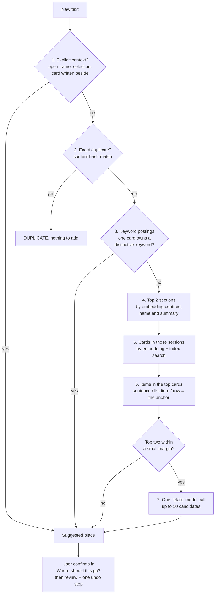

# Embeddings and semantic routing — how Acute finds where new information belongs

*Written 2026-11-14 for engineers and product people new to embeddings or to this part of the code. Sources of
truth: [intelligent-update-engine-plan.md](../intelligent-update-engine-plan.md) §10, §12.20–12.21, §13, and the
spike files in [evaluation/update-engine/embedding-spike/](../../../evaluation/update-engine/embedding-spike/). Where a
doc and the code disagree, the code wins.*

---

## The short answer

When you paste or write something new, Acute has to decide **which card (and which line in it) the new text belongs
to**. Today it compares mostly by **shared words**. That fails whenever the new text says the same thing in other
words, and it is fooled when an unrelated card happens to share words.

The plan is to add a **small sentence-embedding model that runs on the user's device** (`all-MiniLM-L6-v2`, 8-bit,
English first). It turns each sentence into a list of 384 numbers that captures its *meaning*, so "Credentials are
rotated every thirty days" lands next to a card about *keys* even though they share no words. In an offline test it
put **22 of 25** notes on the right card, against **6 of 25** for today's word-based method, and it never fell for a
word-sharing trap card (**0 of 14**, against 10 of 14).

Embeddings are used to **rank and shortlist**, never alone to decide "these two sentences are the same fact". That
judgment stays with the existing rules, the AI step, and the user, who confirms every placement.

**Status: the model is measured, not wired in.** The app still uses the old hashed (word-based) embedder by default.
Nothing in this doc changes what the app does today.

---

## Contents

1. [The problem: finding where new information belongs](#1-the-problem-finding-where-new-information-belongs)
2. [What an embedding is](#2-what-an-embedding-is)
3. [How it works in Acute](#3-how-it-works-in-acute)
4. [Why not just put everything in the model's context window?](#4-why-not-just-put-everything-in-the-models-context-window)
5. [Local model, provider API, or the outside design — and what each costs](#5-local-model-provider-api-or-the-outside-design--and-what-each-costs)
6. [The swappable seam](#6-the-swappable-seam)
7. [What the spike measured](#7-what-the-spike-measured)
8. [Making it feel instant (PROPOSED, NOT BUILT)](#8-making-it-feel-instant-proposed-not-built)
9. [Feature flags and a Pro tier (PROPOSED, NOT BUILT)](#9-feature-flags-and-a-pro-tier-proposed-not-built)
10. [Status, risks, open questions](#10-status-risks-open-questions)
11. [Where to look in the code](#11-where-to-look-in-the-code)
12. [Glossary](#12-glossary)

---

## 1. The problem: finding where new information belongs

Acute is a canvas of cards grouped into sections. When new information arrives (a pasted note, an Ask AI answer, a
line placed with "Place text in notes…", an MCP agent's suggestion), the app has to answer three questions:

1. **Which section and card** is this about? (routing)
2. **Where inside that card** — which sentence, list item or table row? (anchoring)
3. **What is the relation** — new detail, an update, a duplicate, a contradiction? (judgment)

Today, step 1 is done by the Stage 2 router (`src/ai/router/router.ts`). It scores each candidate card as:

    routing = 0.5 × semantic + 0.25 × lexical + 0.15 × section + 0.1 × graph   (+ up to 0.1 from past choices)

"Semantic" sounds like meaning, but today it comes from the **hashed embedder** (`src/ai/router/embedding.ts`), which
is built from the text's words, word pairs and letter triples. So in practice almost all of the score is about
**shared words**.

### Why word matching fails

Two failure modes, both measured:

| Failure | Example | What happened |
|---|---|---|
| **Same meaning, other words** (missed) | "Jitter spreads retries out so callers don't retry together" vs a card about retries | Hashed similarity **0.09** (plan §10). It only worked because other signals carried it. |
| | "Incident write-ups for customer-facing downtime are due within a working week" vs the card "Every customer-facing outage gets a written postmortem within five business days" | A typical blind-probe note: almost no shared content words. |
| **Same words, other subject** (fooled) | "The release branch is frozen on Friday" vs "A tree branch fell onto the car park on Friday" | A "decoy" pair from the blind probe set. Word matching scores these as close. |
| | "Each newcomer's mentor checks in every Monday morning…" — should go to the onboarding-buddy card, but a trap card shares more words | The hashed embedder picked the trap card on 10 of 14 such notes. |

The same word-matching weakness shows up in four places, which is why one better retrieval layer helps all of them
(plan §13.1):

- the router's "contains the claim" test (≥ 50 % shared words, §10);
- impact discovery, "where else is this said?" (≥ 0.5 overlap, §11);
- the intent pre-pass;
- the consistency screen's "are these related?" step (§12.21).

**The consistency work shows the cost.** In the second unseen recording (§12.20), 22 pairs of statements truly
contradicted each other. Rules based on wording let only 7 of them through to the AI, and **15 of 22 never reached the
model**, mostly because a new author phrased opposites in different words ("accessible" vs "cannot reach", "free"
vs "pay"). The AI got every pair it did see right (10 of 10). The bottleneck was *finding* the candidates, not judging
them. That is a retrieval problem, and retrieval is what embeddings are good at.

---

## 2. What an embedding is

An **embedding** is a list of numbers (a **vector**) that a model produces from a piece of text. The model is trained
so that texts with similar meaning get vectors that point in similar directions. MiniLM-L6 produces 384 numbers per
text, whatever the text's length.

To compare two texts you compare their vectors with **cosine similarity**: roughly, "how much do these two arrows
point the same way?" 1 means the same direction, 0 means unrelated. Acute normalises every vector to length 1, so the
cosine is just a dot product (multiply matching positions, add them up).

Two things that surprise people:

- **Embeddings measure *aboutness*, not truth.** "Requests are retried 3 times" and "Requests are retried 5 times"
  are very close. The spike confirmed this: faithful and distorted rewrites of the same sentence scored almost the
  same (MiniLM-L6: 0.877 vs 0.900). So an embedding can say "these are about the same thing", never "these agree".
- **Scores are not comparable across models.** For MiniLM-L6, unrelated sentences average **0.06**; for the e5
  multilingual model they average **0.79**. A threshold like "0.3 means related" only makes sense for one model.

**Quantisation** means storing each of the 384 numbers in one byte instead of four. It cuts storage by 4× (384 bytes
per vector instead of 1,536) with a small loss of precision. Acute's seam already supports it (`quantize` /
`dequantize` in `embeddingProvider.ts`). "q8" in the model name means the model's own weights are also stored 8-bit.

**Retrieval** means "find the few most relevant items out of many". Embeddings make retrieval possible when the words
don't match.

---

## 3. How it works in Acute

### The planned pipeline (Stage 5c, plan §13.4)

The router walks down from cheap, certain checks to expensive, uncertain ones, and **stops at the first confident
answer**. Most placements should never reach the model.



Notes on each step:

| Step | What it uses | Model call? | Built? |
|---|---|---|---|
| 1. Explicit context | where the user is working | no | partly (Stage 2 uses the canvas) |
| 2. Exact duplicate | a hash of the item's text | no | planned (5b item index) |
| 3. Keyword postings | each card's distinctive keywords (tf·idf, already computed in `descriptors.ts`) as a keyword → cards list | no | planned (5c) |
| 4. Sections | centroid of the section's card vectors + its name and summary | no | section signal exists in Stage 2; new vectors planned |
| 5. Cards | embedding similarity + the workspace index's search | no | Stage 2 does this with hashed vectors |
| 6. Items | embedding similarity per sentence / list item / table row | no | planned (5b, 5d) |
| 7. Relate call | a small model call on a shortlist | **yes**, only on a small margin | planned (5e), not designed in detail |

### Rules that do not change

- **Two confidences, never blended.** "Is this the right place?" (routing) and "should this edit a sentence?"
  (update) stay separate numbers. The decision uses routing only.
- **`NEEDS_CLARIFICATION`** when the top two are too close (today: within 0.08, in different sections).
- **Canvas-only destinations.** The router never offers an off-canvas document.
- **The user confirms every placement.** The model step only preselects.
- **Routing weights stay as they are until the 5f evaluation set exists** to measure a change (the §12.9 standing
  rule). That includes the 0.25 lexical weight — see §7 for why the spike puts it in question.

### Where word overlap still belongs

The spike showed that mixing word overlap into the similarity score makes every model worse (§7, finding 3): shared
words *are* the trap. So word overlap moves to the **early exits**, where it is a strength:

- an exact duplicate (step 2) is a perfect word match;
- a distinctive keyword owned by one card (step 3) is strong evidence.

Everywhere else, similarity should come from the embedding alone. (Proposed in plan §13.9; not changed in code yet.)

### What embeddings decide, and what they don't

| Use | Embeddings? | Why |
|---|---|---|
| Rank cards and items for a new sentence | **Yes** | Measured: 22/25 right card vs 6/25 |
| Recall-first "related" line for the consistency screen (drop only the clearly unrelated) | **Yes** | MiniLM-L6 at 0.3 lets 95 % of paraphrases through and 0 % of unrelated pairs |
| Decide two statements are the **same claim** | **No** | Paraphrase-vs-decoy AUC was 0.37–0.56 for every model: chance level |
| Decide two statements **contradict** | **No** | Embeddings measure aboutness, not truth; negation, exclusivity and opposite claims need Stage 1 rules and the AI step |

---

## 4. Why not just put everything in the model's context window?

A model's **context window** is how much text it can read in one call. A natural question: on a small canvas, why not
skip embeddings and send every card to the model with the new text?

You can, but:

| Concern | Everything in the context window | Retrieval first (embeddings), then a small context |
|---|---|---|
| Speed | Every placement waits on a model call. Our recorded call took **about 15 s** (15.8 s in §12.20) | Most placements answered locally in milliseconds; the model only on a small margin |
| Money | Every placement is a paid call, and the call grows with the canvas. *Estimate, not measured:* 200 cards at ~50 tokens each ≈ 10k tokens per call | The call stays the same size (≤ 10 candidates) at 50 cards or 25,000 |
| Scale | The workspace index is designed for up to **25,000 objects** (`INDEX_LIMITS.entries` in `src/search/workspaceIndex.ts`) — far beyond one call | Exact search over cached vectors; no limit from the context window |
| Accuracy | Long contexts find a "needle" less reliably *(from general knowledge, not measured here)* | The model sees only the best candidates |
| Privacy | All card text leaves the device on every placement | Text leaves only when a model call is needed and allowed |
| AI off | Nothing works when AI is off (the hosted build has an "AI off" switch) | Routing works fully offline |
| Without embeddings, the cheap filter is… | word overlap, which failed in §12.20 (15 of 22 contradictions never reached the model) | meaning-based |

This "retrieve first, then reason over a small context" pattern is the common industry practice *(from general
knowledge, not verified)*: embeddings pick the ~10 candidates that go into the context window.

**"Only embed when necessary" is still possible**, as *lazy* embedding (PROPOSED, NOT BUILT):

- embed nothing on a canvas until its first placement or check; then cache the vectors (in idb) and re-embed only
  changed items;
- on a small canvas, simply score every card — locally that is cheap (one new text embeds in about 2–4 ms; comparing
  against cached vectors is microseconds per comparison).

What you **can't** skip is embedding the existing cards: finding a card that shares no words with the new text means
comparing against that card's vector.

---

## 5. Local model, provider API, or the outside design — and what each costs

### What "our own model" means

Not training a model. It means running an **off-the-shelf open model on the user's device**. That is routine today
through libraries like transformers.js and the ONNX runtime. The spike did exactly this, in Node, on CPU.

### What other apps do *(from general knowledge, not verified)*

| Pattern | Examples | Fits when |
|---|---|---|
| Provider embedding API, data on a server | Notion AI, Mem, most SaaS knowledge tools, Copilot/Cursor-style code indexing | the data already lives on the vendor's server |
| Small local model | Obsidian's Smart Connections plugin, AnythingLLM's built-in local embedder, Reor, Khoj offline mode, tools built on transformers.js/ONNX | the product is local-first or privacy-first |
| Hybrid: local by default, optional cloud | a growing pattern | both |

Acute is local-first (Electron desktop app, data in the browser's IndexedDB, an "AI off" mode for the hosted build,
and a privacy-first cloud-sync plan), so it belongs in the local group.

### Why local suits Acute

- **Short texts.** Acute embeds sentences, list items and card titles — what ~384-dimension models like MiniLM,
  BGE-small and E5-small are trained for.
- **Frequent embedding.** Every accepted change re-embeds the changed items. Per-call network cost and latency would
  add up with a provider.
- **Privacy.** Card text never leaves the device, matching the cloud-sync plan's privacy-first stance.
- **The bar is low.** The hashed embedder scored 0.09 on an obvious paraphrase.

### What local really costs (measured where the spike measured it)

| Cost | Estimate in the side conversation | Measured by the spike |
|---|---|---|
| Weights (download or build size) | 25–130 MB | **22.6 MB** (MiniLM-L6) to **129.1 MB** (multilingual models) |
| Load (cold start) | "cold start" | **251 ms** from cache for MiniLM-L6; 1.1–1.3 s for the 129 MB models; first download 0.6–34 s depending on size and network |
| Per text | — | MiniLM-L6: **1.75 ms** batched, **4.47 ms** one at a time (CPU, Node 22, Windows x64) |
| Memory | "memory, hence a worker" | MiniLM-L6: **+86 MB** in an isolated process; MiniLM-L12 multilingual: **+364 MB** |
| Web build speed (WASM / WebGPU) | slower / varies | **Not measured.** The web bundle and the Electron build were not tried |
| Languages | best small models English-only | Confirmed: only the multilingual MiniLM-L12 matched translations (3/3) |
| Changing models | re-embed everything | Handled by design: every vector carries its embedder id, and vectors from two embedders are never compared |
| Quality ceiling | negation, exclusivity, opposite claims need rules + model | Confirmed: paraphrase-vs-decoy judgments were at chance level for every model |

### Cost comparison

Money figures for providers are **from general knowledge, not verified**. "Our recorded rate" comes from §12.20:
1,721 tokens cost $0.00018, i.e. about $0.0001 per 1,000 tokens.

| | Local model (plan) | Provider embeddings API | Outside design ("AI Topic Accumulation Design") | Context window only |
|---|---|---|---|---|
| Money per embedding | **$0** (paid once in engineering and download size) | small embedding models are priced around a few cents per million tokens *(not verified)*. ~20 tokens per item → 10,000 items ≈ 200k tokens, a fraction of a cent | its embedding model is never named | — |
| Model calls | only on a small margin (5e) | same as local | **a small-model call on every capture** (Tier 1), a large model for close calls / merges / splits / routing cards (Tier 2), consolidation calls (every 5 captures, after quiet periods, nightly), summaries on open | **every placement** |
| Rough money scale | ≈ $0 for most placements | ≈ $0 | *Estimate at our recorded rate:* ~1.5–2k tokens per capture ≈ $0.0002; 50 captures/day ≈ **$0.01 per user per day**, before Tier 2 and consolidation | grows with canvas size |
| Latency | ms locally; ~15 s only when the model is needed | a network round trip per batch | a model call per capture (ours took ~15 s) | ~15 s per placement |
| Infrastructure | none new | opt-in, spend guards, the AI-off switch (§6) | PostgreSQL + pgvector (HNSW across the workspace, exact search inside a node): a hosted database with a running cost. Its SQLite / sqlite-vec local variant was never run | the AI pipeline |
| Text leaves the device | no | yes | yes | yes |
| Works with AI off | routing still works, on the hashed embedder; the local model itself stays off with AI off (decision 2026-11-14, plan §13.12) | no | no | no |

**Money is not the reason to choose local** — a provider API would also be cheap. The reasons are privacy, offline
use, no network latency, and no extra infrastructure.

### When a provider API would be the better choice

- if retrieval quality on the 5f evaluation set isn't good enough with a local model;
- if broad multilingual support is needed;
- if the hosted product moves to server-side indexing.

If the web build turns out too slow for the local model, the fallback is **the hashed embedder for web**, not dropping
the local model on desktop.

---

## 6. The swappable seam

The plan's key design rule (§13.2): **the seam is the deliverable; the model is its first implementation.** All of
this is built in [src/ai/router/embeddingProvider.ts](../../../src/ai/router/embeddingProvider.ts) (spike, not wired).

```
            createEmbeddingProvider(config)        <- the only place a concrete embedder is chosen
                         |
     +-------------------+--------------------+
     |                   |                    |
 hashedProvider    LocalModelProvider      remote (deps.remote)
 "local-hash-v1"   "local-minilm-l6-q8-v1" "remote-<name>-<model>"
 kind: local       kind: local             kind: remote  -> NOT BUILT
 always ready      falls back to hashed    throws "not built" today
                   if it can't load
```

| Rule | How the code enforces it |
|---|---|
| Callers never import a concrete embedder | `createEmbeddingProvider(config)` is the one factory |
| Vectors from two embedders are never compared | every `EmbeddingVector` carries `embedder`; `similarity()` throws `EmbedderMismatchError` |
| Callers see only vectors and similarity | dense vs sparse is hidden behind `similarity()` |
| Thresholds belong to the embedder | `provider.thresholds.related` (hashed 0.2, MiniLM-L6 0.3; other models marked uncalibrated) |
| Routing never stops working | `withFallback(local, hashed)` uses the hashed embedder when the model can't load |
| No surprise network use | `LocalModelProvider` downloads only when `allowDownload` is true (default false) |
| Changing models is safe | a new embedder id means stored vectors are stale; the plan re-embeds in the background (index-health states: fresh / stale / rebuilding / failed) |

**Configuration** is one string, read by `embeddingConfigFrom()`:

| Value | Result |
|---|---|
| `hashed` (or unset, or anything unknown) | the hashed embedder — today's default |
| `local-model:minilm-l6` | MiniLM-L6, falling back to hashed |
| `remote:<name>:<model>` | a provider API — throws today, not built |

The code comment names `NEXT_PUBLIC_EMBEDDINGS` as the intended env variable "once wired". It is not read anywhere yet.

### Switching to a provider API later

Write a third implementation with `kind: "remote"` and pass it in through `EmbeddingFactoryDeps.remote`. No caller
changes. The seam's test file already swaps in a fake provider API by configuration. A real one would additionally
need (none of it built):

1. **`AICapabilities.embeddings`** set true for that provider (it exists in `src/ai/types.ts` and is false for every
   provider today);
2. **the AI-spend guards and budget**, like any other paid call;
3. **an explicit user opt-in**, because card text leaves the device;
4. **the hosted "AI off" switch** (`NEXT_PUBLIC_AI_FEATURE` in `src/config/features.ts`) respected.

---

## 7. What the spike measured

The **5a spike** (plan §13.9, 2026-11-14) ran offline, CPU only, with no AI provider call. Full tables are in
[report.md](../../../evaluation/update-engine/embedding-spike/report.md); raw numbers in
[results.json](../../../evaluation/update-engine/embedding-spike/results.json) and
[memory.json](../../../evaluation/update-engine/embedding-spike/memory.json).

### The test material

- **The meaning paraphrase set** (352 pairs). Too easy: the rewritten cards reuse their source's words, so *every*
  embedder, hashed included, scored AUC 1.0. It couldn't separate anything — which is why a blind set was written.
- **The blind probe set** ([probes.json](../../../evaluation/update-engine/embedding-spike/probes.json)), written by an
  isolated agent that saw no code, model or earlier set:
  - 80 pairs, 20 each of: paraphrase (≤ 1 shared content word), same topic, decoy (≥ 2 shared words, different
    subject), unrelated;
  - a 20-card, 5-section canvas with 25 notes to place; 14 of them have a trap card that shares words.
- The Stage 2 router test cases.

### Results

Numbers below are from `results.json` / `report.md` (speed, load) and `memory.json` (memory, one fresh process per
model). Card and section counts are out of 25; "trapped" is out of 14.

| Embedder | Weights | Load from cache | Per text: batched / single | Memory added | Right card | Right section | Trapped | Translations |
|---|---|---|---|---|---|---|---|---|
| hashed (today) | — | — | 0.04 / 0.08 ms | — | 6 | 9 | 10 | 0/3 |
| **MiniLM-L6 (recommended)** | **22.6 MB** | **251 ms** | **1.75 / 4.47 ms** | **86 MB** | **22** | **23** | **0** | 0/3 |
| BGE-small-en | 33.1 MB | 384 ms | 4.34 / 6.67 ms | 96 MB | 22 | 23 | 2 | 0/3 |
| Arctic-embed-xs | 22.6 MB | 287 ms | 2.13 / 3.82 ms | not isolated | 19 | 22 | 3 | 0/3 |
| e5-small multilingual | 129.1 MB | 1,213 ms | 3.89 / 7.74 ms | not isolated | 20 | 21 | 4 | 0/3 |
| MiniLM-L12 multilingual | 129.1 MB | 1,145 ms | 3.10 / 8.57 ms | 364 MB | 15 | 17 | 7 | **3/3** |

### What it means

1. **Ranking is where a model wins.** Choosing among a canvas's cards, MiniLM-L6 went from 6 to 22 of 25 and never
   picked a word-sharing trap card. That is exactly the Stage 2 router's weakness.
2. **Absolute "same fact?" judgments don't improve.** Paraphrase-vs-decoy AUC was 0.37–0.56 for every model (chance
   is 0.5; hashed scored 0). Out of context, no model could tell "same fact, other words" from "same words, other
   subject". So: use embeddings to **rank**, and as a **recall-first relatedness line** — never alone to decide two
   statements are the same claim. MiniLM-L6 at its 0.3 line passes 95 % of paraphrases, 45 % of same-topic pairs,
   90 % of decoys and 0 % of unrelated pairs. For a recall-first screen that is the right direction; the cost is
   decoys forwarded to the AI step.
3. **Blending in word overlap makes it worse.** Every 50/50 mix of a model with the hashed score lost. MiniLM-L6 went
   from 22 to 18 of 25 right, and from 0 to 7 trapped. **Implication:** word overlap belongs in the early exits
   (exact duplicate, keyword postings), not mixed into similarity. This questions the router's 0.25 lexical weight,
   but that weight **stays unchanged** until the 5f evaluation set measures it.
4. **Only the multilingual MiniLM-L12 matched translations** (3 of 3, English card vs its German / French / Spanish
   translation). It costs about 4× the memory (364 MB) and is worse at English routing (15 of 25). If other languages
   are needed, it is a separate configuration, not the default.
5. **Score ranges differ a lot.** Unrelated text averages 0.06 with MiniLM-L6 and 0.79 with e5. Per-embedder
   thresholds are required. Only MiniLM-L6's 0.3 line was checked; the others are marked uncalibrated in code.
6. **Stage 2 router cases, by embedding alone:** "Credentials are rotated every thirty days" → keys at 0.56 (hashed
   0.21). "Jitter spreads retries out…" → *timeouts* by 0.023, a miss that the full router's other signals cover
   today. Recorded, not tuned.

### The §13.2 gate for making the model the default

| Gate | Status |
|---|---|
| Paraphrase cases rank above the line the hashed embedder missed | **Met** on the blind probes; one Stage 2 case is a near-miss by embedding alone |
| No existing router or screen test lowered | **Not measurable until wiring**; all router tests pass with hashed still the default |
| A routed placement stays within the §12.6 latency budget once vectors are cached | **Met for cached vectors**: a new text embeds in about 4 ms; comparison is microseconds |

Not measured: brute-force search time over ~10,000 item vectors (plan §13.10 R15 asks for this; revisit if p95 >
~20 ms), web-build speed, the worker, and the local reranker idea (R20).

---

## 8. Making it feel instant (PROPOSED, NOT BUILT)

> Everything in this section is a **proposal**. Plan §13.10 ("Latency and perceived speed", rules R1–R22) records it
> as adopted in principle, but nothing is built and only the model call's ~15 s has been measured. Product examples
> are **from general knowledge, not verified**.

**The principle:** the user never waits on the slow part. A fast deterministic answer appears at once; the slow work
finishes in the background and shows up only if it adds something. It **suggests**; it never moves anything on its
own. (Similar patterns: optimistic updates reconciled later in Linear and Superhuman, "underline first, explain on
demand" in Grammarly, Copilot's ghost text, review bots with a count badge.)

| Idea | What it means for the user | Plan rule |
|---|---|---|
| **Answer first, refine later** | The router's pick shows immediately. If the model call agrees, a small "AI agrees" mark; if not, a quiet "AI suggests *X* instead" chip. Nothing re-sorts under the cursor | R1 |
| **Late answer after the user acted** | Becomes a review-panel entry, "Move to *X*?", with one undo step. Never a silent move | R2 |
| **Drop stale answers** | If the text, dialog or canvas changed, the late answer is thrown away; closing the dialog cancels the call | R3 |
| **A time budget, not a spinner** | After ~20 s (proposed), "checking…" becomes "not checked", recorded as pending and retryable | R4 |
| **Optimistic commit** | Accept applies at once; the consistency check runs after commit and appears as a badge or panel entry | R5 (already built for 4a–4e) |
| **Clear status words** | "Placed" (instant) vs "Checked by AI" (later). "AI agrees" only when a call really ran | R6 |
| **Embed while typing** | Debounce ~300 ms, embed the draft in a worker, so candidates are ready at "Place" | R7 |
| **Pre-route on selection** | Selecting a card or Ask AI answer computes candidates in the background, so "Place in notes…" opens filled | R8 |
| **Speculative model call — only when justified** | Only when the place dialog is open, the margin is already small, and AI is on within budget | R9 |
| **Invisible model loading** | Load the model in a worker at idle time after startup; the hashed embedder answers until it's ready; an open dialog is not re-ranked when it becomes ready | R10, R11 |
| **Download consent** | If weights are downloaded rather than bundled, no large download on a metered connection or without the user's setting | R12 |
| **Incremental indexing** | Re-embed only changed items after commit; full rebuilds after a model switch run at low priority with the index-health badge | R13 |
| **Persisted, quantised vectors** | Stored in idb keyed by (embedder id, content hash), one byte per number; a reload never re-embeds | R14 |
| **Exact search, no ANN index** | Brute force is expected to be fast enough at ~10k × 384; **not yet measured** | R15 |
| **Cache model answers** | By (claim hash, item hash, model id, prompt version) | R16 |
| **Batch background checks only** | ≤ 10-pair batches for after-commit checks; never delay an interactive placement to join a batch | R17 |
| **Streaming** | Optional, into the explanation line only; **not verified** for our provider setup | R18 |
| **Measure the call before working around it** | 15 s is one configuration (gpt-oss-120b on AICredits, with reasoning). A smaller, faster model might change which rules matter — needs a paid-run proposal and approval | R19 |
| **Local reranker as a middle tier** | A small local cross-encoder could settle close cases without a paid call; option, not decided | R20 |
| **Queue, don't interrupt** | Findings collect in the review panel with a count badge; no modal after commit | R22 |

**Where the plan refined the side conversation:**

- Pre-routing on **hover was dropped** (R8): it fires too often and churns the worker.
- Speculative model calls are limited to an **open dialog inside the margin band, within budget** (R9) — calls on
  selection or hover would spend money and send text away before the user asked.
- Using past choices to **"learn to skip" the model is deferred** to after 5f (R21): it changes routing weights and
  risks a feedback loop.
- Stale-answer handling, cancellation and a time budget (R3, R4) were added.

**Main risks:** the UI changing after the user acted (R1–R3), wasted speculative spend (R9), worker contention during
a rebuild (R13).

---

## 9. Feature flags and a Pro tier (PROPOSED, NOT BUILT)

### What exists today

Searched `src/` for feature-flag, plan, tier, entitlement and subscription concepts:

- **Feature flags:** [src/config/features.ts](../../../src/config/features.ts) holds **build-time, operator-level
  switches, not user settings**:
  - `NEXT_PUBLIC_AI_FEATURE` — whether the build ships AI at all (off = no AI UI, `/api/ai/*` answers 404);
  - `NEXT_PUBLIC_TOPIC_MERGE` — topic merge;
  - `MCP_FEATURE` (server-enforced), `NEXT_PUBLIC_MCP_FEATURE` (UI hint), `MCP_OAUTH_FEATURE` — MCP access.

  There is **no embedding flag** there. The embedder choice has its own config parser, `embeddingConfigFrom()`, which
  mentions `NEXT_PUBLIC_EMBEDDINGS` "once wired", but nothing reads that variable yet.
- **Plans / tiers / entitlements: none built.** No accounts, no free-vs-Pro concept, no billing.
  - The only code hook is a placeholder in [src/mcp/tools/common.ts](../../../src/mcp/tools/common.ts): an optional
    `ToolPolicy.entitlement()` and an `entitlement_required` refusal shape (decision D49). Its own comment says
    "Nothing is gated in this build … no policy sets it."
  - Docs describe a future Free / Pro split ([acute-mcp-vision-spec.md](../acute-mcp-vision-spec.md): "Entitlements /
    billing / plan gating — ❌ Not built"), but it is planning only.
  - Words that look related are not: **"tier"** in `src/` means the *processing* tier (`"local" | "ai"`) or the
    `VectorTier` index, and **"subscription"** is an AI-connection auth type (e.g. a Copilot subscription).
- **AI spend guards** exist for paid calls (budgets and caps in the consistency and ingest paths), which a remote
  embedder would reuse.

### Guidance (PROPOSED)

**A feature flag for the local model: yes.** The seam already picks the embedder from one configuration value, so it
can roll out dev → beta → everyone, or keep the web build on `hashed` while desktop uses `local-model:minilm-l6`.
Wiring that value to an env variable (`NEXT_PUBLIC_EMBEDDINGS` as the code suggests) next to the other switches in
`features.ts` is the natural place.

**Gating the local model behind Pro: not recommended.** It costs nothing to run per use and improves the core
feature. Gating it would make free routing worse to save no money.

**What would fit a paid tier, because it costs money** (all future, none built):

| Candidate | Why it costs money |
|---|---|
| The "relate" model call (5e) | a paid model call |
| The AI consistency check (Stage 4f, currently OFF) | a paid model call |
| A provider embeddings API (`kind: "remote"`), if ever built | per-token charges; text leaves the device |
| Cross-canvas or cloud-synced indexing, once cloud sync exists | server storage and compute |
| Larger or multilingual models | download size and memory rather than money; could be an optional add-on |

---

## 10. Status, risks, open questions

### Status (2026-11-14)

| Piece | Status |
|---|---|
| `EmbeddingProvider` seam, hashed adapter, quantisation, fallback, factory | **Built** (new files), 13 offline tests |
| `LocalModelProvider` (transformers.js 4.3.2, ONNX, q8) | **Built**, used only by the spike |
| Spike measurement (`EMBEDDING_SPIKE=1`, opt-in) | **Done**, results in `evaluation/update-engine/embedding-spike/` |
| Wiring into `VectorTier` / the router | **Not done** — the default is still the hashed embedder |
| Worker, idb vector store, item-level index (5b), descent (5c), anchors (5d), relate call (5e), locate evaluation set (5f) | **Not built** |
| Stage 4f (AI consistency check) | **OFF**; takes priority where the two touch. `embedding.ts` and the screen are frozen until the third unseen recording |

### Risks found by the spike

- **`sharp`** — a hard dependency of transformers.js used only for images — carries a high-severity advisory (in its
  SVG decoder). Embedding never calls it, but it would ship in the build. Resolve before wiring (override to a fixed
  version, or exclude it from the desktop package).
- **The worker isn't built**, and the **web (Next.js) bundle and Electron build were not tried**. Desktop constraints
  from earlier work apply (webpack-only, the after-pack copy step).
- **Small probe set:** 80 pairs, 25 notes, one author. The figures are indicative; 5f decides the thresholds.
- transformers.js settings are global, so only one configured model at a time.
- `npm install` reported 43 advisories across the tree; one (`sharp`) is from the new packages.

### Open questions (plan §13.8 and §13.10)

1. ~~Which local model~~ — provisionally MiniLM-L6. At 22.6 MB it can ship in the desktop build (no first-run wait);
   the web build can download on first use.
2. **Web build:** the model, or the hashed embedder only? Open.
3. ~~Languages~~ — provisionally English first; multilingual (MiniLM-L12) is a separate configuration.
4. After the third unseen recording: does AI consistency move into the relate call, get a limited live test, or stay
   off with the rules-only panel? Open.
5. The R4 time budget (20 s proposed).
6. When to evaluate the local reranker (R20).
7. Whether R19's model comparison becomes a paid proposal before or as part of the 5e design.
8. ~~Should the local embedder run when the build's AI flag is off?~~ **Decided 2026-11-14 (plan §13.12): no, for
   now.** With AI off, no local model inference and no model download; the factory returns the hashed embedder
   (tested). Later, three separate controls: deterministic search (always on), local semantic search (its own
   setting), hosted AI (the AI setting and provider authorization).

### Order of work (plan §13.7)

1. 4f: blind labels, one approved paid run, report.
2. ✅ 5a spike (done).
3. 5f: the locate evaluation set, held-out part fixed first.
4. 5a wiring: `VectorTier` reads the provider; the default switches only if the gate passes (after step 1).
5. 5b item index → 5c descent → 5d anchors.
6. 5e relate call — design, then a proposal for any live check.

---

## 11. Where to look in the code

| File | What it is |
|---|---|
| [src/ai/router/embeddingProvider.ts](../../../src/ai/router/embeddingProvider.ts) | The seam: `EmbeddingProvider`, `similarity`, `quantize`, `withFallback`, `embeddingConfigFrom`, `createEmbeddingProvider` |
| [src/ai/router/localModelEmbedding.ts](../../../src/ai/router/localModelEmbedding.ts) | `LocalModelProvider` and the five candidate models (`LOCAL_MODELS`) with their thresholds |
| [src/ai/router/embedding.ts](../../../src/ai/router/embedding.ts) | The hashed embedder (`local-hash-v1`) and `VectorTier` — what the app uses today. Frozen until the third unseen recording |
| [src/ai/router/router.ts](../../../src/ai/router/router.ts) | `routeContent`: `WEIGHTS` (0.5 / 0.25 / 0.15 / 0.1), `ROUTE_FLOOR` 0.2, `CLARIFY_MARGIN` 0.08 |
| [src/ai/router/descriptors.ts](../../../src/ai/router/descriptors.ts) | Per-card title, summary and tf·idf keywords (the future keyword postings) |
| `src/ai/router/embeddingProvider.test.ts` | 13 offline tests of the seam |
| `src/ai/router/embeddingSpike.test.ts` | The spike — **opt-in only** (`EMBEDDING_SPIKE=1`), downloads model weights |
| [src/ai/consistency/screen.ts](../../../src/ai/consistency/screen.ts) | The consistency screen's relatedness line (hashed cosine ≥ 0.2) |
| [src/search/workspaceIndex.ts](../../../src/search/workspaceIndex.ts) | The workspace index, `INDEX_LIMITS` (25,000 objects) |
| [src/config/features.ts](../../../src/config/features.ts) | Build-time feature switches |
| [src/ai/types.ts](../../../src/ai/types.ts) | `AICapabilities.embeddings` (false for every provider) |
| [evaluation/update-engine/embedding-spike/](../../../evaluation/update-engine/embedding-spike/) | `report.md`, `results.json`, `memory.json`, `probes.json` |
| [.ai/docs/intelligent-update-engine-plan.md](../intelligent-update-engine-plan.md) | §10 (router), §12.20–12.21 (why word overlap failed), §13 (this plan) |

---

## 12. Glossary

| Term | Meaning |
|---|---|
| **Embedding** | A list of numbers a model produces from a text, arranged so that texts with similar meaning get similar numbers |
| **Vector** | A list of numbers treated as a direction in space. MiniLM-L6 vectors have 384 numbers (**dimensions**) |
| **Dense / sparse vector** | Dense: every position has a value (the models). Sparse: only a few positions are non-zero (the hashed embedder, 65,536 buckets) |
| **Cosine similarity** | How closely two vectors point the same way: 1 = same direction, 0 = unrelated. On normalised vectors it is a dot product |
| **Quantisation** | Storing each number in fewer bits — here one byte instead of four — to save memory and storage at a small precision cost. "q8" = 8-bit |
| **Retrieval** | Finding the few most relevant items among many, before doing anything expensive with them |
| **Context window** | How much text a language model can read in one call |
| **Embedder** | Anything that turns text into vectors: the hashed embedder or a model. Each has a stable id, e.g. `local-minilm-l6-q8-v1` |
| **Hashed embedder** | Today's embedder: words, word pairs and letter triples hashed into a sparse vector. Fast, but only catches shared words |
| **Centroid** | The average of several vectors — a section's "centre", from its cards |
| **Threshold / related line** | The similarity above which two texts count as related. Per embedder (hashed 0.2, MiniLM-L6 0.3) |
| **Paraphrase / decoy** | Paraphrase: same meaning, different words. Decoy: shared words, different subject |
| **AUC** | A 0–1 score of how well a number separates two groups: 1 = perfectly, 0.5 = chance |
| **ANN (approximate nearest neighbour)** | An index that finds similar vectors quickly by approximating; not planned, since exact search is expected to be fast enough at Acute's scale |
| **transformers.js / ONNX runtime** | Libraries that run open models in JavaScript, on the device |
| **Worker** | A background thread in the browser or Electron, so model work never freezes the UI |
| **idb** | IndexedDB, the browser database Acute stores data in |
| **Stage 5a–5f** | The plan's steps: 5a seam + model, 5b item index, 5c descent, 5d anchors, 5e relate call, 5f evaluation set |
